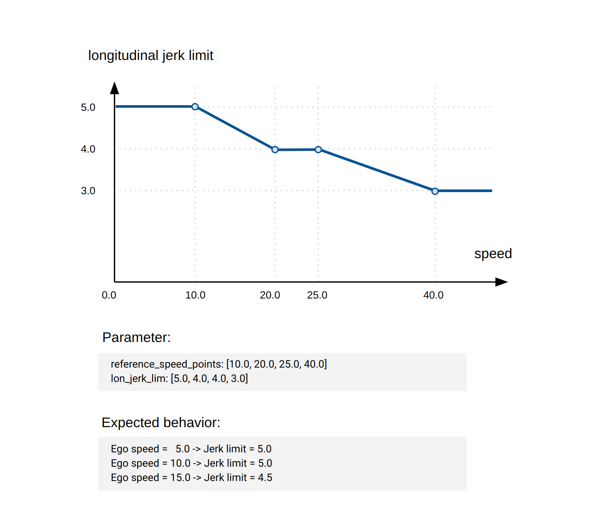

# autoware_control_command_gate

## Overview

This package subscribes to multiple commands, selects one and publish it.
Here, unless otherwise specified, command refers to a set of four commands: control, gear, turn_indicators, and hazard_lights.
Each command input is identified as a command source, which has a numeric ID and a name (see the `inputs` and `inputs_names` parameters).
The node also applies a filter (nominal or transition) to the selected commands to correct for obvious abnormal values.

## Requirements

- Functional
  - Subscribe to multiple commands as command source.
  - Generate a builtin stop command as command source.
  - Select one from the command sources and publish it.
  - Filter abnormal values in the command selected.
  - Filter the command selected smoothly on mode transition when requested.
  - Support parking mode for humans to explicitly stop the vehicle (T.B.D.).
- Safety
  - Detect timeouts for each command source.
  - Select builtin stop when selected command source is not available.

## Interfaces

### Command inputs

For each command source listed in the `inputs` parameter, the following topics are subscribed.
The `<source>` part is the source name given by `inputs_names.<id>` (e.g. `main`, `emergency_stop`).

| Name                                | Type                                              | Description                             |
| ----------------------------------- | ------------------------------------------------- | --------------------------------------- |
| `~/inputs/<source>/control`         | `autoware_control_msgs/msg/Control`               | control command from the source         |
| `~/inputs/<source>/gear`            | `autoware_vehicle_msgs/msg/GearCommand`           | gear command from the source            |
| `~/inputs/<source>/turn_indicators` | `autoware_vehicle_msgs/msg/TurnIndicatorsCommand` | turn indicators command from the source |
| `~/inputs/<source>/hazard_lights`   | `autoware_vehicle_msgs/msg/HazardLightsCommand`   | hazard lights command from the source   |

### Vehicle status inputs

These topics are used by the command filter.

| Name                              | Type                                           | Description                         |
| --------------------------------- | ---------------------------------------------- | ----------------------------------- |
| `/localization/kinematic_state`   | `nav_msgs/msg/Odometry`                        | current velocity and stop state     |
| `/localization/acceleration`      | `geometry_msgs/msg/AccelWithCovarianceStamped` | current acceleration                |
| `/vehicle/status/steering_status` | `autoware_vehicle_msgs/msg/SteeringReport`     | current steering angle              |
| `/vehicle/status/control_mode`    | `autoware_vehicle_msgs/msg/ControlModeReport`  | current control mode of the vehicle |

### Command outputs

| Name                       | Type                                              | Description                           |
| -------------------------- | ------------------------------------------------- | ------------------------------------- |
| `~/output/control`         | `autoware_control_msgs/msg/Control`               | selected and filtered control command |
| `~/output/gear`            | `autoware_vehicle_msgs/msg/GearCommand`           | selected gear command                 |
| `~/output/turn_indicators` | `autoware_vehicle_msgs/msg/TurnIndicatorsCommand` | selected turn indicators command      |
| `~/output/hazard_lights`   | `autoware_vehicle_msgs/msg/HazardLightsCommand`   | selected hazard lights command        |

### Filter status

| Name                    | Type                                                  | Description                                                                                                              |
| ----------------------- | ----------------------------------------------------- | ------------------------------------------------------------------------------------------------------------------------ |
| `~/is_filter_activated` | `autoware_control_command_gate/msg/IsFilterActivated` | whether the filter is activated and which limits are applied (published only when `enable_command_limit_filter` is true) |

### Source and filter management

| Name              | Type                                        | Description                                                    |
| ----------------- | ------------------------------------------- | -------------------------------------------------------------- |
| `~/source/status` | `tier4_system_msgs/msg/CommandSourceStatus` | (pub) currently selected command source                        |
| `~/filter/status` | `tier4_system_msgs/msg/CommandFilterStatus` | (pub) whether the transition filter is enabled                 |
| `~/source/change` | `tier4_system_msgs/srv/ChangeCommandSource` | (srv) change the command source                                |
| `~/filter/change` | `tier4_system_msgs/srv/ChangeCommandFilter` | (srv) enable or disable the transition filter                  |
| `~/source/select` | `tier4_system_msgs/srv/SelectCommandSource` | (srv) change the command source and transition filter together |

### Compatibility interfaces

These interfaces are provided for compatibility with `vehicle_cmd_gate`.

| Name                                           | Type                                       | Description                                                      |
| ---------------------------------------------- | ------------------------------------------ | ---------------------------------------------------------------- |
| `/control/vehicle_cmd_gate/set_pause`          | `tier4_control_msgs/srv/SetPause`          | (srv) pause request from AD API                                  |
| `/control/vehicle_cmd_gate/is_paused`          | `tier4_control_msgs/msg/IsPaused`          | (pub) whether the vehicle is paused                              |
| `/control/vehicle_cmd_gate/is_start_requested` | `tier4_control_msgs/msg/IsStartRequested`  | (pub) whether the selected command requests the vehicle to start |
| `/control/vehicle_cmd_gate/set_stop`           | `tier4_control_msgs/srv/SetStop`           | (srv) moderate stop request                                      |
| `/control/vehicle_cmd_gate/is_stopped`         | `tier4_control_msgs/msg/IsStopped`         | (pub) moderate stop state and its requesting sources             |
| `/api/autoware/set/emergency`                  | `tier4_external_api_msgs/srv/SetEmergency` | (srv) external emergency request                                 |
| `/api/autoware/get/emergency`                  | `tier4_external_api_msgs/msg/Emergency`    | (pub) external emergency state                                   |

### Diagnostics

| Name               | Description                                                       |
| ------------------ | ----------------------------------------------------------------- |
| `timeout_<source>` | timeout of the control command from each source (incl. `builtin`) |
| `timeout_output`   | timeout of the output control command                             |

## Parameters

| Parameter                        | Type      | Description                                                                                                                   |
| -------------------------------- | --------- | ----------------------------------------------------------------------------------------------------------------------------- |
| `inputs`                         | int array | IDs of the command sources to subscribe. See `autoware_command_mode_types/sources.hpp`. `builtin` and `unknown` are reserved. |
| `inputs_names.<id>`              | string    | source name for each ID in `inputs`, used as the topic namespace `~/inputs/<source>/`                                         |
| `rate`                           | double    | update rate [Hz] of the source selection and status publication                                                               |
| `builtin_emergency_acceleration` | double    | longitudinal acceleration of the builtin stop command                                                                         |
| `stop_hold_acceleration`         | double    | longitudinal acceleration upper limit while paused by AD API                                                                  |
| `emergency_acceleration`         | double    | longitudinal acceleration upper limit while external emergency is requested                                                   |
| `moderate_stop_acceleration`     | double    | longitudinal acceleration upper limit while moderate stop is requested                                                        |
| `diag_timeout_warn_duration`     | double    | duration [s] without a control command until the timeout diagnostics becomes WARN                                             |
| `diag_timeout_error_duration`    | double    | duration [s] without a control command until the timeout diagnostics becomes ERROR                                            |
| `stop_check_duration`            | double    | duration [s] used to determine that the vehicle is stopped                                                                    |
| `enable_command_limit_filter`    | bool      | enable the command limit filter                                                                                               |
| `nominal_filter.*`               | -         | filter parameters used when the transition filter is disabled (see below)                                                     |
| `transition_filter.*`            | -         | filter parameters used when the transition filter is enabled (see below)                                                      |

The vehicle info parameters (`wheel_base`, etc.) are also required for the filter.

### Filter parameters

The following parameters are common to `nominal_filter` and `transition_filter`.
The array parameters are interpolated by the current velocity using `reference_speed_points`, so they must have the same size as `reference_speed_points`.

| Parameter                               | Type         | Description                                                         |
| --------------------------------------- | ------------ | ------------------------------------------------------------------- |
| `vel_lim`                               | double       | limit of longitudinal velocity                                      |
| `reference_speed_points`                | double array | velocity points used as a reference to interpolate the limit arrays |
| `lon_acc_lim_for_lon_vel`               | double array | limits for longitudinal acceleration                                |
| `lon_jerk_lim_for_lon_acc`              | double array | limits for longitudinal jerk                                        |
| `lat_acc_lim_for_steer_cmd`             | double array | limits for lateral acceleration                                     |
| `lat_jerk_lim_for_steer_cmd`            | double array | limits for lateral jerk                                             |
| `steer_cmd_lim`                         | double array | limits for steering angle                                           |
| `steer_rate_lim_for_steer_cmd`          | double array | limits for steering rate                                            |
| `lat_jerk_lim_for_steer_rate`           | double       | limit for lateral jerk constraint on steering rate                  |
| `steer_cmd_diff_lim_from_current_steer` | double array | limits for difference between current and command steering angle    |

### Parameter Naming Convention

The parameters follow specific naming patterns to clearly distinguish between different types of constraints and their relationships:

#### Pattern 1: `[constraint]_lim_for_[target]`

- **Format**: `[physical_constraint]_lim_for_[controlled_variable]`
- **Description**: Defines limits based on physical constraints (acceleration, jerk, etc.) applied to control variables

#### Pattern 2: `[target]_[constraint]_lim_from_[reference]`

- **Format**: `[controlled_variable]_[constraint_type]_lim_from_[reference_variable]`
- **Description**: Defines limits on the difference or deviation of a control variable from a reference value

#### Pattern 3: `[target]_lim`

- **Format**: `[controlled_variable]_lim`
- **Description**: Defines absolute limits for control variables

## Functionality

### Main Functionality

- Receive multiple control commands (from Autoware planning, emergency handler, remote control, etc.) and select one to forward to the vehicle.
- Apply a final guard on the selected command to enforce absolute safety limits (e.g., maximum steering rate). This is not a comfort filter.
- Enforce transition guards during mode changes into autonomous driving (e.g., remote→autonomous, manual→autonomous) to limit sudden changes. Integration with the Operation Transition Manager is recommended, though code boundaries should be maintained due to its complexity.

### Sub-Functionality

- Detect timeouts of the control command for each command source and for the output, and report them as diagnostics.
- Publish `~/is_filter_activated` indicating whether the final guard is active. Active guard in autonomous mode implies an unexpected constraint in command generation and requires attention.
- Publish `~/filter/status` indicating whether the transition filter is enabled, so that other nodes can tell that a mode transition is in progress.
- Override the selected command to stop when requested by the compatibility interfaces (AD API pause, moderate stop, and external emergency).

### Filter function

This module incorporates a limitation filter to the control command right before its published. Primarily for safety, this filter restricts the output range of all control commands published through Autoware.

The filter has two parameter sets: `nominal_filter` and `transition_filter`.
The `transition_filter` is used while the transition flag is set by `~/filter/change` or `~/source/select`, and the `nominal_filter` is used otherwise.
The whole filter can be disabled by `enable_command_limit_filter`.

While the vehicle is not in autonomous control mode, the filter uses the actual vehicle state (steering, velocity and acceleration) as the previous command, to prevent sudden changes when control is switched to Autoware.

The limitation values are calculated based on the 1D interpolation of the limitation array parameters. Here is an example for the longitudinal jerk limit.

Notation: this filter is not designed to enhance ride comfort. Its main purpose is to detect and remove abnormal values in the control outputs during the final stages of Autoware. If this filter is frequently active, it implies the control module may need tuning. If you're aiming to smoothen the signal via a low-pass filter or similar techniques, that should be handled in the control module. When the filter is enabled by `enable_command_limit_filter`, the filter activation status is published to `~/is_filter_activated` for each control command.

Notation 2: If you use vehicles in which the driving force is controlled by the accelerator/brake pedal, the jerk limit, denoting the pedal rate limit, must be sufficiently relaxed at low speeds.
Otherwise, quick pedal changes at start/stop will not be possible, resulting in slow starts and creep down on hills.
This functionality for starting/stopping was embedded in the source code but was removed because it was complex and could be achieved by parameters.

## Assumptions / Known limits

### External Emergency

An external emergency can be requested via the `/api/autoware/set/emergency` service and is kept until it is released by the same service.
Unlike `vehicle_cmd_gate`, heartbeat monitoring of the external module is not performed.
While the emergency is requested, the selected control command is overridden to stop with `emergency_acceleration`.

### Command Source Timeout

If the selected command source does not receive the control command for `diag_timeout_error_duration`, the builtin stop command is selected automatically.
A request to select a command source that is in timeout is rejected.

### Commands on Source Changes

When the command source is changed, the last `gear`, `turn_indic- This node depends on the Operation Mode Transition Manager for Engage state transitions at the design level.ators` and `hazard_lights` commands received from the new source are published immediately.
If the new source has not received them yet, the previous output is kept until the new source receives them.
When the builtin source is selected, the gear is kept (`NONE`), the turn indicators are disabled, and the hazard lights are enabled.

## Caution

- Tests are essential and must be retained.
