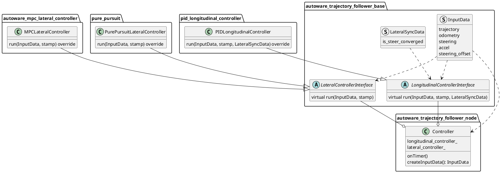

# Trajectory Follower Nodes

## Purpose

Generate control commands to follow a given Trajectory.

## Design

This is a node of the functionalities implemented in the controller class derived from [autoware_trajectory_follower_base](../autoware_trajectory_follower_base/README.md#trajectory-follower) package. It has instances of those functionalities, gives them input data to perform calculations, and publishes control commands.

By default, the controller instance with the `Controller` class as follows is used.



The process flow of `Controller` class is as follows.

```cpp
// 1. create input data
const auto input_data = createInputData(*get_clock());
if (!input_data) {
  return;
}

// 2. run the lateral controller
const auto lat_result = lateral_controller_->run(*input_data, stamp);
if (!lat_result) {
  return;
}

// 3. run the longitudinal controller
const auto lon_result =
  longitudinal_controller_->run(*input_data, stamp, previous_lateral_sync_data_);

// 4. keep the lateral result for the longitudinal controller of the next cycle
previous_lateral_sync_data_ = lat_result->sync_data;
if (!lon_result) {
  return;
}

// 5. publish control command
control_cmd_pub_->publish(out);
```

Giving the longitudinal controller information about steer convergence allows it to control steer when stopped if following parameters are `true`

- lateral controller
  - `keep_steer_control_until_converged`
- longitudinal controller
  - `enable_keep_stopped_until_steer_convergence`

### Inputs / Outputs / API

#### Inputs

- `autoware_planning_msgs/Trajectory` : reference trajectory to follow.
- `nav_msgs/Odometry`: current odometry
- `autoware_vehicle_msgs/SteeringReport` current steering

#### Outputs

- `autoware_control_msgs/Control`: message containing both lateral and longitudinal commands.
- `autoware_control_msgs/ControlHorizon`: message containing both lateral and longitudinal horizon commands. this is NOT published by default. by using this, the performance of vehicle control may be improved, and by turning the default on, it can be used as an experimental topic.

#### Parameter

- `trajectory_reference_mode`: `spatial` or `temporal` (default: `spatial`)
  - `spatial`: the reference trajectory is tracked based on distance, calculating the time step of
    each prediction point from distance and velocity.
  - `temporal`: the reference trajectory's `time_from_start` field is used directly to track the
    trajectory based on time steps.
  - This parameter is declared here and shared with the lateral (MPC) and longitudinal (PID)
    controllers.
- `ctrl_period`: control commands publishing period
- `timeout_thr_sec`: duration in second after which input messages are discarded.
  - Each time the node receives lateral and longitudinal commands from each controller, it publishes an `Control` if the following two conditions are met.
    1. Both commands have been received.
    2. The last received commands are not older than defined by `timeout_thr_sec`.
- `cyclic_message_timeout_thr_sec`: duration in second for monitoring incoming trajectory messages via diagnostic updater (default: 0.9)
  - The diagnostic updater will report ERROR status if:
    1. No trajectory message has been received yet.
    2. The elapsed time since the last trajectory message exceeds this threshold.
  - This parameter helps monitor the health of the trajectory input stream.
- `lateral_controller_mode`: `mpc` or `pure_pursuit`
  - (currently there is only `PID` for longitudinal controller)
- `enable_control_cmd_horizon_pub`: publish `ControlHorizon` or not (default: false)

## Debugging

Debug information are published by the lateral and longitudinal controller using `autoware_internal_debug_msgs/Float32MultiArrayStamped` messages.

A configuration file for [PlotJuggler](https://github.com/facontidavide/PlotJuggler) is provided in the `config` folder which, when loaded, allow to automatically subscribe and visualize information useful for debugging.

In addition, the predicted MPC trajectory is published on topic `output/lateral/predicted_trajectory` and can be visualized in Rviz.
