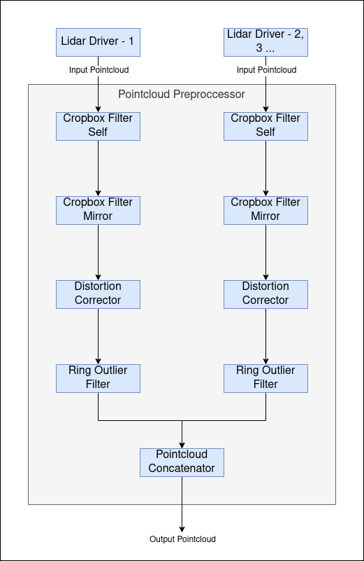

# autoware_pointcloud_preprocessor

## Purpose

The `autoware_pointcloud_preprocessor` is a package that includes the following filters:

- removing outlier points
- cropping
- concatenating pointclouds
- correcting distortion
- downsampling
- densifying pointclouds

## Inner-workings / Algorithms

Detail description of each filter's algorithm is in the following links.

| Filter Name                   | Description                                                                        | Detail                                        |
| ----------------------------- | ---------------------------------------------------------------------------------- | --------------------------------------------- |
| concatenate_data              | subscribe multiple pointclouds and concatenate them into a pointcloud              | [link](docs/concatenate-data.md)              |
| crop_box_filter               | remove points within a given box                                                   | [link](docs/crop-box-filter.md)               |
| distortion_corrector          | compensate pointcloud distortion caused by ego vehicle's movement during 1 scan    | [link](docs/distortion-corrector.md)          |
| downsample_filter             | downsampling input pointcloud                                                      | [link](docs/downsample-filter.md)             |
| outlier_filter                | remove points caused by hardware problems, rain drops and small insects as a noise | [link](docs/outlier-filter.md)                |
| polar_voxel_noise_filter      | remove point cloud noise using polar-coordinate voxels and return-type-aware rules | [link](docs/polar-voxel-noise-filter.md)      |
| passthrough_filter            | remove points on the outside of a range in given field (e.g. x, y, z, intensity)   | [link](docs/passthrough-filter.md)            |
| pointcloud_accumulator        | accumulate pointclouds for a given amount of time                                  | [link](docs/pointcloud-accumulator.md)        |
| pointcloud_densifier          | enhance sparse point clouds by using information from previous frames              | [link](docs/pointcloud-densifier.md)          |
| vector_map_filter             | remove points on the outside of lane by using vector map                           | [link](docs/vector-map-filter.md)             |
| vector_map_inside_area_filter | remove points inside of vector map area that has given type by parameter           | [link](docs/vector-map-inside-area-filter.md) |

## Inputs / Outputs

### Input

| Name              | Type                            | Description       |
| ----------------- | ------------------------------- | ----------------- |
| `~/input/points`  | `sensor_msgs::msg::PointCloud2` | reference points  |
| `~/input/indices` | `pcl_msgs::msg::Indices`        | reference indices |

### Output

| Name              | Type                            | Description     |
| ----------------- | ------------------------------- | --------------- |
| `~/output/points` | `sensor_msgs::msg::PointCloud2` | filtered points |

## Parameters

### Node Parameters

| Name               | Type   | Default Value | Description                           |
| ------------------ | ------ | ------------- | ------------------------------------- |
| `input_frame`      | string | " "           | input frame id                        |
| `output_frame`     | string | " "           | output frame id                       |
| `max_queue_size`   | int    | 5             | max queue size of input/output topics |
| `use_indices`      | bool   | false         | flag to use pointcloud indices        |
| `latched_indices`  | bool   | false         | flag to latch pointcloud indices      |
| `approximate_sync` | bool   | false         | flag to use approximate sync option   |

## Assumptions / Known limits

`autoware::pointcloud_preprocessor::Filter` is implemented based on pcl_perception [1] because
of [this issue](https://github.com/ros-perception/perception_pcl/issues/9).

## Python binding for point cloud concatenation

The concatenation core (`CloudConcatenator`, which the `concatenate_data` node runs) can be used
from Python through `autoware_pointcloud_preprocessor.concatenate_pointclouds`. It is built and
installed with the package, so no extra build option is needed. It takes and returns rclpy messages
and needs no ROS node: no `rclpy.init()`, no executor and no TF listener. This makes it useful for
offline work such as re-concatenating a rosbag.

```python
from autoware_pointcloud_preprocessor.concatenate_pointclouds import Concatenator, FrameStatus

concatenator = Concatenator(
    ["/sensing/lidar/top/pointcloud", "/sensing/lidar/left/pointcloud"],
    output_frame="base_link",
    timeout_sec=0.1,
)
concatenator.set_transform(top_to_base_link)  # a TransformStamped per sensor frame
concatenator.set_transform(left_to_base_link)
concatenator.process_twist(twist)  # TwistWithCovarianceStamped; or process_odometry(odometry)

# Feed the clouds in arrival order. The arrival time (seconds) replaces the node's clock.
for frame in concatenator.process_cloud("/sensing/lidar/top/pointcloud", cloud, arrival_time=t):
    if frame.status is FrameStatus.COMPLETE:
        merged = frame.result.concatenated_cloud  # sensor_msgs.msg.PointCloud2

# At the end of the stream, close the collectors that are still open (as TIMEOUT frames).
remaining = concatenator.flush()
```

Each frame carries `status` (`COMPLETE`, `TIMEOUT` or `LATE`), `result.concatenated_cloud`,
`result.concatenation_info`, `result.motion_compensation_status` and
`result.dropped_sources_missing_transform`. `frame.build_diagnostics()` returns the
`DiagnosticStatus` the node would publish for it.

- `set_transform()` takes the transform from the sensor frame into the output frame
  (`header.frame_id` = output frame, `child_frame_id` = sensor frame). Any other form raises
  `ValueError`.
- An unknown topic, a `PointCloud2` without the PointXYZIRC fields or an invalid option raises
  `ValueError`. A message of the wrong type raises `TypeError`.
- For the `advanced` matching strategy, pass `matching_strategy="advanced"` together with
  `lidar_timestamp_offsets` and `lidar_timestamp_noise_window`, as in the node's parameters.

A runnable example is [`examples/concatenate_without_ros_node.py`](#concatenate_without_ros_nodepy).
For reading a rosbag and for reproducing the node exactly (`max_open_collectors`,
`reject_late_clouds`), see [Offline use from Python](docs/concatenate-data.md#offline-use-from-python).

## Examples

The C++ examples are not built by default, so release builds do not pay for them. Enable them with
`-DBUILD_EXAMPLES=ON`:

```bash
colcon build --packages-select autoware_pointcloud_preprocessor \
  --cmake-args -DCMAKE_BUILD_TYPE=Release -DBUILD_EXAMPLES=ON
```

### concatenate_without_ros_node

Concatenates three point clouds through the `concatenate_core` library alone: no node, no executor
and no spinning. Clouds, transforms and twist are handed to the core directly, so every input is
guaranteed to be processed - unlike a pub/sub pipeline, where a subscriber that comes up late
silently misses messages. This makes it a convenient starting point for replaying recorded data
deterministically, and for measuring concatenation cost on its own.

```bash
./build/autoware_pointcloud_preprocessor/concatenate_without_ros_node [points_per_cloud] [iterations] [warmup]
```

| Argument           | Default | Description                               |
| ------------------ | ------- | ----------------------------------------- |
| `points_per_cloud` | 40000   | points in each of the three source clouds |
| `iterations`       | 200     | timed concatenations                      |
| `warmup`           | 20      | untimed runs before measuring             |

The example verifies the concatenated cloud and the diagnostics, then reports the time spent inside
`combine_pointclouds()` only. Building the clouds, the transforms and the grouping all happen
outside the measured region.

```text
concatenated cloud
  frame_id   : base_link
  stamp      : 1000
  points     : 120000
  point_step : 16
  sources    : 3
  frames     : 1

concatenation time over 200 runs
  average : 78.601 ms
  stddev  : 1.603 ms
  min     : 75.894 ms
  median  : 79.222 ms
  p95     : 80.293 ms
  max     : 81.265 ms
  rate    : 1.53 Mpoint/s (12.72 concatenations/s)
```

The absolute figures depend on the machine; use them to compare runs, not as a specification.

Build with `-DCMAKE_BUILD_TYPE=Release` before reading anything into the timings. Without it the
package compiles unoptimized and the same run is roughly 80x slower.

### concatenate_without_ros_node.py

The Python counterpart of `concatenate_without_ros_node`, using the
[Python binding](#python-binding-for-point-cloud-concatenation). It concatenates the same three clouds
and makes the same checks, but does not measure timings. It needs no build option. From the
workspace root:

```bash
colcon build --packages-select autoware_pointcloud_preprocessor --cmake-args -DCMAKE_BUILD_TYPE=Release
source install/setup.bash
python3 src/universe/autoware_universe/sensing/autoware_pointcloud_preprocessor/examples/concatenate_without_ros_node.py [points_per_cloud]
```

| Argument           | Default | Description                               |
| ------------------ | ------- | ----------------------------------------- |
| `points_per_cloud` | 40000   | points in each of the three source clouds |

```text
concatenated cloud
  frame_id   : base_link
  stamp      : 1000
  points     : 120000
  point_step : 16
  sources    : 3
  frames     : 1

  ok   cloud is in the output frame
  ok   every source contributed its points
  ...

PASS: concatenation ran without a ROS node
```

## Measuring the performance

In Autoware, point cloud data from each LiDAR sensor undergoes preprocessing in the sensing pipeline before being input
into the perception pipeline. The preprocessing stages are illustrated in the diagram below:



Each stage in the pipeline incurs a processing delay. Mostly, we've used `ros2 topic delay /topic_name` to measure
the time between the message header and the current time. This approach works well for small-sized messages. However,
when dealing with large point cloud messages, this method introduces an additional delay. This is primarily because
accessing these large point cloud messages externally impacts the pipeline's performance.

Our sensing/perception nodes are designed to run within composable node containers, leveraging intra-process
communication. External subscriptions to these messages (like using ros2 topic delay or rviz2) impose extra delays and
can even slow down the pipeline by subscribing externally. Therefore, these measurements will not be accurate.

To mitigate this issue, we've adopted a method where each node in the pipeline reports its pipeline latency time.
This approach ensures the integrity of intra-process communication and provides a more accurate measure of delays in the
pipeline.

### Benchmarking The Pipeline

The nodes within the pipeline report the pipeline latency time, indicating the duration from the sensor driver's pointcloud
output to the node's output. This data is crucial for assessing the pipeline's health and efficiency.

When running Autoware, you can monitor the pipeline latency times for each node in the pipeline by subscribing to the
following ROS 2 topics:

- `/sensing/lidar/LidarX/crop_box_filter_self/debug/pipeline_latency_ms`
- `/sensing/lidar/LidarX/crop_box_filter_mirror/debug/pipeline_latency_ms`
- `/sensing/lidar/LidarX/distortion_corrector/debug/pipeline_latency_ms`
- `/sensing/lidar/LidarX/ring_outlier_filter/debug/pipeline_latency_ms`
- `/sensing/lidar/concatenate_data_synchronizer/debug/sensing/lidar/LidarX/pointcloud/pipeline_latency_ms`

These topics provide the pipeline latency times, giving insights into the delays at various stages of the pipeline
from the sensor output of LidarX to each subsequent node.

## (Optional) Error detection and handling

## (Optional) Performance characterization

## References/External links

[1] <https://github.com/ros-perception/perception_pcl/blob/ros2/pcl_ros/src/pcl_ros/filters/filter.cpp>

## (Optional) Future extensions / Unimplemented parts
